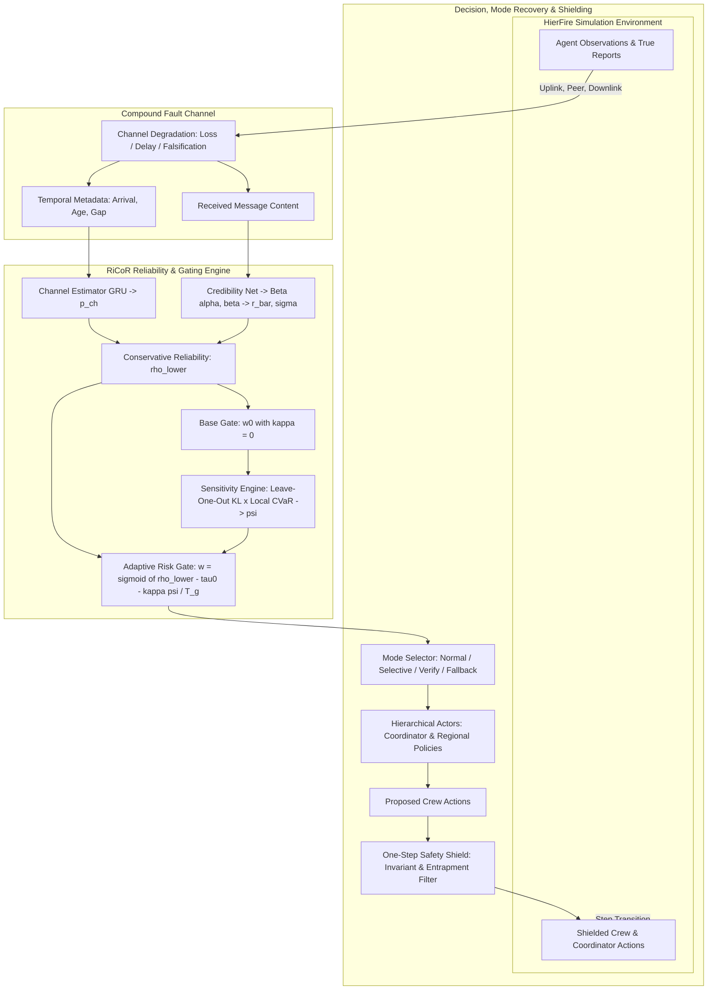

# RiCoR: Risk-Calibrated Communication and Adaptive Safe Recovery in Hierarchical MARL

[](https://www.python.org/)
[](https://pytorch.org/)
[](tests/)
[](LICENSE)
[](https://github.com/astral-sh/ruff)

Official research implementation of *"Risk-Calibrated Communication and Adaptive Safe Recovery in Hierarchical Multi-Agent Reinforcement Learning under Compound Communication Failures"*.

---

> [!IMPORTANT]
> **Study Status & Empirical Findings (Revised Manuscript):**
> - The initial submission contained illustrative planning targets rather than measured values. The revised manuscript reports only empirical measurements obtained using this codebase in a **reduced-budget study** (`configs/experiments/revision.yaml`: $2 \times 10^5$ environment steps per run, 200-step episodes, 3 seeds per method, bound, and ablation, with 30 evaluation episodes per condition and seed).
> - **Empirical Outcome:** In the reduced-budget regime, RiCoR did **not** outperform established baselines. It exhibited the lowest Asset Protection Rate (APR) across condition groups, HPSF proved the strongest overall method, no pairwise differences survived Holm step-down correction, and RiCoR's learned mode selector converged to degenerate modes in two of the three seeds. See Section 7 of the revised manuscript and `../results/`.
> - The compute-intensive paper-scale study (`configs/experiments/full.yaml`: $10^7$ steps, 8 seeds) has **not** been run due to CPU rollout constraints (~40+ CPU-hours per method-seed).
>
> **Key Revision Updates (2026-10-25):**
> - **Privileged Information Removed from Execution:** The coordinator's risk assessment relies strictly on a decentralized critic evaluated over actually received reports, verification replies use neighbors' local border-view observations, and credibility features use exclusively the receiver's inbox (`tests/integration/test_system.py::test_execution_never_reads_the_global_state`).
> - **Methodological Corrections:** Evaluated the Eq. (7) tail risk term under the induced action distribution, added discounted cost-critic targets, implemented per-region drop-target knowledge, restricted latency metrics to decision-only steps, enabled causal recovery smoothing, reported FAR/FRR at the operational gate threshold, and added $\text{CVaR}_{0.9}$ cost tracking.
> - **Expanded Evaluation Suite:** Added baseline `beta_rep` (Beta-reputation), performance bounds `oracle_gate` and `no_comm`, slow-drift adversary `U4`, and compromised-fraction sweeps `K1` and `K4`.

---

## Table of Contents

- [Overview](#overview)
- [System Architecture](#system-architecture)
- [Key Contributions & Code Mapping](#key-contributions--code-mapping)
- [Repository Structure](#repository-structure)
- [Installation](#installation)
  - [Prerequisites](#prerequisites)
  - [Standard Setup (pip)](#standard-setup-pip)
  - [Alternative Setup (uv)](#alternative-setup-uv)
  - [Docker Container](#docker-container)
- [Quick Start](#quick-start)
- [Execution Workflows](#execution-workflows)
  - [Training](#training)
  - [Evaluation & Statistical Aggregation](#evaluation--statistical-aggregation)
  - [Running the Revision Study](#running-the-revision-study)
  - [Inference & Episode Diagnostics](#inference--episode-diagnostics)
  - [Scenario Generation](#scenario-generation)
- [Configuration System](#configuration-system)
- [Reproducibility & Verification](#reproducibility--verification)
- [Limitations & Assumptions](#limitations--assumptions)
- [Development & Quality Assurance](#development--quality-assurance)
- [Troubleshooting](#troubleshooting)
- [Citation](#citation)
- [License](#license)

---

## Overview

In hierarchical multi-agent reinforcement learning (MARL) for safety-critical environments—such as wildfire disaster response—agents coordinate under imperfect and hostile communication channels. RiCoR coordinates a central coordinator and $N$ regional commanders operating over an unreliably shared, lossy, and adversarially manipulated wireless substrate (modeling loss, delays, packet corruption, replays, and falsification).

RiCoR dynamically regulates information flow and team behavior through three interconnected mechanisms:

1. **Factorized Channel & Evidential Reliability:**
   - **Channel Health ($p_{\mathrm{ch}}$):** A Recurrent Neural Network (GRU) processes message temporal metadata (arrival flag, normalized age, sequence gap) to assess link state.
   - **Content Credibility ($\bar{r}, \sigma$):** A Dirichlet/Beta evidential neural network outputs a posterior over message truthfulness, quantifying distributional uncertainty $\sigma$.
   - **Lower Confidence Bound ($\rho_{\mathrm{lower}}$):** Combines both terms conservatively:
     $$\rho_{\mathrm{lower}} = p_{\mathrm{ch}} \cdot \max(0, \bar{r} - \lambda_u \sigma)$$

2. **Risk-Conditioned Policy Gating:**
   - Evaluates decision sensitivity ($\psi$) via a leave-one-out policy divergence ($D_{\mathrm{KL}}$) weighted by the downstream tail risk ($\text{CVaR}_\alpha$) from decentralized critic networks.
   - Computes message attention weights via an adaptive sigmoid gate:
     $$w = \sigma\left(\frac{\rho_{\mathrm{lower}} - \tau_0 - \kappa \psi}{T_g}\right)$$

3. **Multi-Mode Safe Recovery & Action Shielding:**
   - A learned supervisory selector dynamically transitions team protocol among four operating regimes: **Normal**, **Selective**, **Verify** (border-view peer cross-validation), and **Fallback**.
   - A deterministic, low-level **One-Step Safety Shield** monitors every crew action and projects dangerous actions to the most probable admissible action to prevent crew entrapment.

---

## System Architecture

The following diagram illustrates the decision and information-flow pipeline during an execution step:



---

## Key Contributions & Code Mapping

All algorithms, mathematical formulations, and experimental frameworks map directly to code modules:

| Paper Component | Formulation / Spec | Implementation Files | Primary Classes / Methods |
|---|---|---|---|
| **Evidential Reliability** | Eqs. (4)–(6) | [`src/ricor/core/reliability.py`](src/ricor/core/reliability.py), [`src/ricor/models.py`](src/ricor/models.py) | `evidential_beta()`, `factorized_reliability()`, `ChannelEstimator`, `CredibilityNet` |
| **Risk-Conditioned Gate** | Eqs. (7)–(9) | [`src/ricor/core/gate.py`](src/ricor/core/gate.py), [`src/ricor/system.py`](src/ricor/system.py), [`src/ricor/models.py`](src/ricor/models.py) | `risk_conditioned_gate()`, `RiCoRSystem._sensitivity()`, `GatedAttention` |
| **Four-Mode Safe Recovery** | Eq. (10) | [`src/ricor/core/modes.py`](src/ricor/core/modes.py), [`src/ricor/system.py`](src/ricor/system.py) | `ModeSelector`, `apply_recovery_mode()`, `RiCoRSystem._apply_mode()` |
| **One-Step Action Shield** | Eq. (11) | [`src/ricor/core/shield.py`](src/ricor/core/shield.py) | `ActionShield`, `filter_crew_action()`, `admissible_actions()` |
| **PPO-Lagrangian & Reliability Loss** | Eqs. (12)–(14) | [`src/ricor/training.py`](src/ricor/training.py) | `Trainer.train()`, `Trainer._update_ppo()`, `Trainer._reliability_loss()` |
| **Compound Fault Taxonomy** | Table II (F1–F6, C1–C3, U1–U4) | [`src/ricor/comm/faults.py`](src/ricor/comm/faults.py), [`src/ricor/comm/channel.py`](src/ricor/comm/channel.py) | `FaultSpec`, `FaultTaxonomy`, `Channel.transmit()` |
| **HierFire Environment** | Sec. VI-A (48×48 grid, 8 regions) | [`src/ricor/envs/hierfire.py`](src/ricor/envs/hierfire.py) | `HierFireEnv`, `border_view()`, `step()` |
| **Baselines & Ablations** | Sec. VI-D (HPSF, ADMAC-H, etc.) | [`configs/methods/`](configs/methods/) | `ricor.yaml`, `hpsf.yaml`, `admac_h.yaml`, `h_mappo.yaml`, `beta_rep.yaml`, `ablations/*.yaml` |
| **Border-View Verification** | Sec. IV-C | [`src/ricor/envs/hierfire.py`](src/ricor/envs/hierfire.py), [`src/ricor/comm/channel.py`](src/ricor/comm/channel.py) | `HierFireEnv.border_view()`, `Channel.verification_reply()` |
| **Evaluation & Statistical Tests** | Sec. VI-E (Holm, Welch, CIs) | [`src/ricor/evaluation/runner.py`](src/ricor/evaluation/runner.py), [`src/ricor/evaluation/aggregate.py`](src/ricor/evaluation/aggregate.py) | `evaluate()`, `aggregate_runs()`, `bootstrap_ci()`, `welch_t_test()` |
| **Paper Artifact Generation** | Sec. VII | [`scripts/make_paper_artifacts.py`](scripts/make_paper_artifacts.py), [`scripts/run_study.py`](scripts/run_study.py) | `make_paper_artifacts.py`, `run_study.py` |

Component implementation status: [IMPLEMENTATION_STATUS.md](IMPLEMENTATION_STATUS.md) · Design assumptions: [docs/assumptions.md](docs/assumptions.md) · Mapping guide: [docs/paper_implementation_mapping.md](docs/paper_implementation_mapping.md).

---

## Repository Structure

```text
.
├── configs/                       # Hierarchical YAML configuration files
│   ├── env/                       # Environment geometry and fire spread parameters
│   ├── evaluation/                # Evaluation conditions, sweep parameters, and protocols
│   ├── experiments/               # Experiment profiles (full.yaml, revision.yaml, smoke.yaml)
│   ├── methods/                   # Model configurations (ricor, hpsf, admac_h, h_mappo, beta_rep)
│   │   └── ablations/             # Table VII ablation variants (kappa0, no_shield, etc.)
│   ├── scenarios/                 # Map dataset partition rules
│   └── training/                  # Optimizer and curriculum schedules
├── docs/                          # In-depth architectural and operational guides
│   ├── architecture.md            # Tensor shapes, execution graph, and system pipelines
│   ├── assumptions.md             # Formal documentation of engineering assumptions (A1–A30)
│   ├── evaluation.md              # Evaluation protocols, metrics, and aggregation
│   ├── inference.md               # Diagnostic single-episode tracing
│   ├── paper_implementation_mapping.md # Line-by-line equation-to-code mapping
│   ├── reproducibility.md         # Compute requirements and reproducibility notes
│   ├── setup.md                   # Detailed platform installation instructions
│   ├── training.md                # Curriculum progression and loss formulations
│   └── troubleshooting.md         # Common runtime failure modes and resolutions
├── scripts/                       # Executable entry points for training and analysis
│   ├── aggregate.py               # Aggregates evaluation checkpoints across seeds
│   ├── evaluate.py                # Evaluates model checkpoints across conditions
│   ├── generate_scenarios.py      # Generates deterministic map splits
│   ├── honest_majority.py         # Evaluates verification under Byzantine conditions
│   ├── infer.py                   # Generates detailed per-step diagnostic JSON traces
│   ├── make_paper_artifacts.py    # Generates manuscript tables, plots, and numbers
│   ├── run_study.py               # Multiprocessing orchestrator for the revision study
│   ├── smoke_test.py              # Rapid end-to-end CPU verification harness
│   └── train.py                   # Runs policy training for a specified method and seed
├── src/
│   └── ricor/                    # Core Python package
│       ├── cli.py                 # Command-line interface bindings
│       ├── comm/                  # Fault injection, Gilbert-Elliott channel, and metadata
│       ├── config.py              # Schema validation and YAML composition
│       ├── core/                  # Mathematical equations (reliability, gate, modes, shield)
│       ├── envs/                  # Cellular automaton fire simulation and agent mechanics
│       ├── evaluation/            # Statistical testing, metrics, and report builders
│       ├── models.py              # Neural network definitions (Actor, Critic, GRU, Credibility)
│       ├── scenarios.py           # Map generator and scenario split manifest management
│       ├── system.py              # Algorithm 1 batched execution loop
│       ├── training.py            # PPO-Lagrangian trainer and Lagrangian multiplier update
│       └── utils.py               # Seeding, serialization, and logging utilities
├── tests/                         # Pytest test suite (52 tests)
│   ├── integration/               # System execution, PPO updates, checkpoint round-trips
│   ├── smoke/                     # Pipeline execution and CLI argument tests
│   └── unit/                      # Mathematical unit tests for all equations
├── Dockerfile                     # Container specification for hermetic testing
├── Makefile                       # Development shortcuts (lint, test, install)
├── pyproject.toml                 # Packaging metadata and entry-point specifications
├── requirements.txt               # Pinned runtime dependencies
├── requirements-dev.txt           # Pinned development and testing dependencies
├── IMPLEMENTATION_STATUS.md       # Audit checklist and component maturity
└── SMOKE_TEST_REPORT.md           # Empirical validation report from repository construction
```

---

## Installation

### Prerequisites

- **Python Version:** Supported on **Python 3.10 through 3.13**. (Python 3.14+ is unsupported as PyTorch publishes no wheels for it).
- **Tested Environment:** Windows 11 (Python 3.12.15) and Ubuntu Linux 22.04 LTS (Python 3.11).
- **Hardware Requirements:** CPU-only operation is fully supported. Training at paper scale is CPU-bound due to Python-level environment stepping.

### Standard Setup (pip)

1. **Clone the repository:**
   ```bash
   git clone https://github.com/Himanshu3122/Risk-Calibrated-Communication-and-Adaptive-Safe-Recovery-in-Hierarchical-Multi-Agent-RL..git
   cd Risk-Calibrated-Communication-and-Adaptive-Safe-Recovery-in-Hierarchical-Multi-Agent-RL.
   ```

2. **Create and activate a virtual environment:**
   - **Linux / macOS:**
     ```bash
     python -m venv .venv
     source .venv/bin/activate
     ```
   - **Windows (PowerShell):**
     ```powershell
     python -m venv .venv
     .venv\Scripts\Activate.ps1
     ```

3. **Install PyTorch (CPU wheel):**
   ```bash
   pip install --index-url https://download.pytorch.org/whl/cpu torch==2.5.1
   ```
   *(For CUDA builds, select your specific driver wheel from [pytorch.org](https://pytorch.org/get-started/locally/)).*

4. **Install package dependencies and package in editable mode:**
   ```bash
   pip install -r requirements-dev.txt
   pip install --no-deps -e .
   ```

### Alternative Setup (uv)

For significantly faster environment provisioning using [`uv`](https://github.com/astral-sh/uv):

```bash
uv venv --python 3.12 .venv
source .venv/bin/activate             # Windows: .venv\Scripts\Activate.ps1
uv pip install --index-url https://download.pytorch.org/whl/cpu --extra-index-url https://pypi.org/simple torch==2.5.1 -r requirements-dev.txt
uv pip install --no-deps -e .
```

### Docker Container

A minimal CPU container image is provided for clean execution:

```bash
docker build -t ricor .
docker run --rm ricor pytest -q
docker run --rm ricor python scripts/smoke_test.py
```

---

## Quick Start

Run the test suite and the rapid end-to-end smoke verification (~1 minute on standard CPU):

```bash
# 1. Verify environment and run all 52 unit, integration, and smoke tests
pytest

# 2. Run the end-to-end smoke test pipeline across baseline methods
python scripts/smoke_test.py --methods ricor h_mappo admac_h hpsf h_mappo_drop
```

> [!NOTE]
> The smoke workload operates on a small $16 \times 16$ grid with 4 regions and 30-step episodes (`configs/experiments/smoke.yaml`). This confirms complete pipeline functionality (train $\to$ evaluate $\to$ infer $\to$ aggregate) but **does not produce research-grade results**.

---

## Execution Workflows

The repository provides modular scripts under `scripts/`, as well as registered console commands (`ricor-train`, `ricor-evaluate`, `ricor-infer`, `ricor-aggregate`, `ricor-scenarios`):

### Training

Train a method on an experiment specification:

```bash
# Train RiCoR (seed 0) on the smoke experiment
python scripts/train.py --config configs/experiments/smoke.yaml --method configs/methods/ricor.yaml --seed 0

# Train baselines (e.g., HPSF, ADMAC-H, Beta-Reputation)
python scripts/train.py --config configs/experiments/smoke.yaml --method configs/methods/hpsf.yaml --seed 0
python scripts/train.py --config configs/experiments/smoke.yaml --method configs/methods/beta_rep.yaml --seed 0

# Train ablation models (e.g., without risk gating kappa=0)
python scripts/train.py --config configs/experiments/smoke.yaml --method configs/methods/ablations/kappa0.yaml --seed 0

# Override configuration parameters dynamically on CLI
python scripts/train.py --config configs/experiments/smoke.yaml --method configs/methods/ricor.yaml --set method.kappa=2.0 train.total_steps=10000
```

*Outputs are saved to `runs/<experiment>/<method>/seed<k>/` containing `checkpoint.pt`, `checkpoint.json`, `config.json`, and `train_history.json`.*

### Evaluation & Statistical Aggregation

Evaluate trained checkpoints across all 13 operational conditions, packet-loss sweeps, and recovery protocols:

```bash
# Evaluate a trained checkpoint (writes eval.json)
python scripts/evaluate.py --checkpoint runs/smoke/ricor/seed0/checkpoint.pt

# Fast evaluation omitting loss sweeps and recovery windows
python scripts/evaluate.py --checkpoint runs/smoke/ricor/seed0/checkpoint.pt --no-sweep --no-recovery

# Aggregate multi-seed results and run Welch t-tests with Holm step-down correction against HPSF
python scripts/aggregate.py --root runs/smoke --reference hpsf
```

*Aggregation outputs `summary.md` and `summary.json`, detailing sample means, 95% bootstrap confidence intervals, Hedges' $g$, and adjusted $p$-values.*

### Running the Revision Study

To reproduce the reduced-budget study presented in the revised manuscript:

```bash
# 1. Execute all 14 configurations (methods, bounds, ablations) across 3 seeds using worker pool
python scripts/run_study.py --workers 4

# 2. Compile LaTeX tables, dat plots, and quantitative summaries into ../results
python scripts/make_paper_artifacts.py --root runs/revision --out ../results
```

### Inference & Episode Diagnostics

Generate detailed, per-step JSON diagnostic rollouts to inspect communication gating and agent decisions:

```bash
python scripts/infer.py --checkpoint runs/smoke/ricor/seed0/checkpoint.pt --condition C2 --map-index 0 --out trace_C2.json
```

### Scenario Generation

Pre-generate deterministic procedural maps for reproducible train/val/test splits:

```bash
python scripts/generate_scenarios.py --config configs/experiments/smoke.yaml --out smoke_manifest.json
```

---

## Configuration System

All experimental parameters are managed via typed YAML files located in `configs/`:

- `configs/experiments/`: Defines experiment scopes (`full.yaml` for 400-step paper scale, `revision.yaml` for reduced-budget study, `smoke.yaml` for testing).
- `configs/methods/`: Method hyperparameter profiles (`ricor.yaml`, `hpsf.yaml`, `admac_h.yaml`, `h_mappo.yaml`, `h_mappo_drop.yaml`, `beta_rep.yaml`, `oracle_gate.yaml`, `no_comm.yaml`).
- `configs/methods/ablations/`: Ablation studies from Table VII (`kappa0.yaml`, `joint_reliability.yaml`, `no_shield.yaml`, `fixed_modes.yaml`, `point_estimate.yaml`, `no_cost_critic.yaml`).
- `configs/env/`: Environment configurations (`hierfire.yaml`).
- `configs/training/`: Training hyperparameters and curriculum stages (`curriculum.yaml`, `full.yaml`, `smoke.yaml`).

Any parameter can be overridden from the command line using `--set <path>=<value>`, e.g., `--set env.n_regions=4`.

---

## Reproducibility & Verification

- **Software Determinism:** The codebase enforces strict seeding across NumPy, PyTorch, and Python random number generators. Given identical seeds and map manifests, training and evaluation runs produce identical trajectories.
- **Reproducible Artifacts:** The reduced-budget study can be regenerated directly via `scripts/run_study.py` and `scripts/make_paper_artifacts.py`.
- **Validation Report:** A complete log of initial test executions, hardware specifications, and unit/integration verification is maintained in [SMOKE_TEST_REPORT.md](SMOKE_TEST_REPORT.md).
- **Assumptions Documentation:** All 30 engineering assumptions (A1–A30) where the paper paper specification required concrete instantiation are detailed in [docs/assumptions.md](docs/assumptions.md).

---

## Limitations & Assumptions

1. **Fire & Environment Approximations:** HierFire cellular automata propagation rates, wind models, and asset placement distributions are parameterized approximations as original simulation code is proprietary ([docs/assumptions.md#A1](docs/assumptions.md)).
2. **CPU Execution Throughput:** The simulation loop is un-vectorized Python/NumPy, executing at ~0.02s per step on CPU. Paper-scale training ($10^7$ steps) requires distributed clusters or vectorized environments (e.g., JAX/C++ rewrite).
3. **Byzantine Fault Model:** Injected fault heuristic F6 is rule-based rather than an adaptive, policy-aware learned adversary.
4. **Safety Predicate Envelope:** Proposition 1 safety guarantees assume strict local boundary validity; in practice, fire spread can jump across multiple cells, leading to occasional empirical safety violations.
5. **Supervision Requirements:** Evidential reliability training relies on ground-truth fault labels during training, which must be synthetically injected.

---

## Development & Quality Assurance

A `Makefile` is provided for standard engineering tasks:

```bash
make install        # Install production dependencies and local package
make dev            # Install development dependencies (pytest, ruff)
make lint           # Check code syntax and imports via Ruff
make test           # Run complete pytest suite
make unit           # Run unit tests only
make integration    # Run integration tests only
make smoke          # Run smoke tests only
make smoke-pipeline # Execute smoke pipeline across all methods
make clean          # Remove caches, runs, and temporary build files
```

Linting and formatting standards follow `ruff` configurations defined in `pyproject.toml` (target Python 3.10, line length 120).

---

## Troubleshooting

- **`ModuleNotFoundError: No module named 'ricor'`:**
  Ensure the package is installed in editable mode:
  ```bash
  pip install --no-deps -e .
  ```
  Alternatively, run with Python's path set explicitly:
  - Linux/macOS: `PYTHONPATH=src pytest`
  - Windows PowerShell: `$env:PYTHONPATH="src"; pytest`

- **Unsupported Python Version (e.g., Python 3.14 or 3.15):**
  PyTorch currently does not publish prebuilt wheels for Python 3.14+. Provision an environment with Python 3.10–3.13:
  ```bash
  uv venv --python 3.12 .venv
  ```

- **OpenMP Thread Contention / CPU Overload:**
  By default, PyTorch may saturate all available CPU cores. Restrict thread allocation using:
  ```bash
  export OMP_NUM_THREADS=2      # Windows PowerShell: $env:OMP_NUM_THREADS="2"
  ```

- **CUDA Out-of-Memory or Missing CUDA Wheel:**
  The default `requirements.txt` specifies CPU wheels. For GPU execution, install CUDA PyTorch binaries according to [docs/setup.md](docs/setup.md) and set `train.device: cuda`.

For additional debugging insights, refer to [docs/troubleshooting.md](docs/troubleshooting.md).

---

## Citation

If you use this codebase or reference the empirical findings, please cite:

```bibtex
@article{ricor2026,
  title   = {Risk-Calibrated Communication and Adaptive Safe Recovery in Hierarchical Multi-Agent Reinforcement Learning under Compound Communication Failures},
  author  = {Himanshu},
  journal = {arXiv preprint},
  year    = {2026},
  note    = {Research implementation and reduced-budget empirical evaluation}
}
```

---

## License & Governance

- **License:** Licensed under the [MIT License](LICENSE).
- **Contributing:** Contribution guidelines and pull request workflows are outlined in [CONTRIBUTING.md](CONTRIBUTING.md).
- **Code of Conduct:** Community behavior standards are defined in [CODE_OF_CONDUCT.md](CODE_OF_CONDUCT.md).
- **Security:** Vulnerability reporting guidelines are found in [SECURITY.md](SECURITY.md).
- **Changelog:** Major revisions and releases are tracked in [CHANGELOG.md](CHANGELOG.md).
