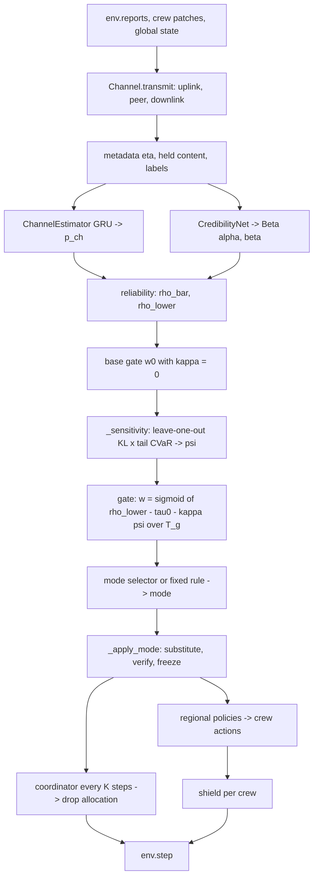

# Architecture

This document describes what the code does. For the mapping to the paper, see [paper_implementation_mapping.md](paper_implementation_mapping.md). For every design choice the paper does not fix, see [assumptions.md](assumptions.md).

## Package layout

```text
src/ricor/
├── config.py          typed YAML configuration (includes, overrides, validation)
├── utils.py           seeding, logging, run directories, JSON I/O
├── scenarios.py       deterministic map-seed split
├── envs/hierfire.py   HierFire simulator (fire CA, crews, drops, assets, safety cost)
├── comm/faults.py     FaultSpec and the F/C/U fault table, training curriculum
├── comm/channel.py    per-link Gilbert-Elliott loss, delay queues, content faults, metadata, labels
├── core/reliability.py  Eqs. (4)-(6), (12)
├── core/gate.py         Eqs. (7)-(8)
├── core/modes.py        modes, hysteresis, Eq. (10), fixed-threshold rule
├── core/shield.py       Eq. (11)
├── models.py          all networks
├── system.py          RiCoRSystem: Algorithm 1 over a batch of episodes
├── training.py        Trainer: curriculum, PPO-Lagrangian, calibration, checkpoints
├── evaluation/        metrics, statistics, protocol runner, aggregation
└── cli.py             command-line entry points used by scripts/
```

## One decision step



### Data shapes (B = episodes in the batch, N = regions, C = crews, L = links)

| Tensor | Shape | Meaning |
|---|---|---|
| reports | [B, N, 16] | true regional reports (what senders transmit) |
| meta | [B, L, 3] | arrived flag, age / 50, sequence-gap flag |
| content links | L_c = N uplinks + peer links | messages that pass reliability gating |
| w | [B, L_c] | gate weight per content link |
| regional messages | [B, N, M, 16] | peer messages per receiver, padded to M = max neighbors |
| coordinator slots | [B, N, 16] | one uplink report per region |
| crew actions | [B, N, C] | 8 actions per crew |

## Training loop

`Trainer.train` runs `ceil(total_steps / (n_envs · episode_length))` iterations. Each iteration:

1. Picks the curriculum stage from training progress (clean → isolated → compound; always clean for H-MAPPO).
2. Samples `n_envs` training maps and fault specs, then runs complete episodes with stochastic policies.
3. Computes GAE for reward (value critic) and for cost (mean of the quantile cost critic), and forms the advantage A = A_R − λ·A_C.
4. Runs `ppo_epochs` × `minibatches` PPO updates for the regional policies, the coordinator (decision steps only), and the mode selector (Eq. 10 reward, own value head). The same updates fit the value critic, the team cost critic (quantile regression to Monte-Carlo cost returns), and the per-crew cost Q (quantile SARSA TD).
5. Once per epoch, applies the reliability loss (Eq. 12) to the channel GRU (unrolled over the episode) and the credibility head, plus the HPSF predictor loss when enabled.
6. Updates λ with Eq. (14) from the empirical CVaR of episode costs.

After the last iteration, `Trainer.calibrate` fits the temperatures of p_ch and r̄ on validation maps. A checkpoint (`checkpoint.pt` plus `checkpoint.json` metadata) and `train_history.json` are written to `runs/<name>/<method>/seed<k>/`.

## Evaluation

`evaluation/runner.py::evaluate` runs deterministic policies on the first `episodes_per_condition` test maps for each condition. It then runs the F1 loss sweep and the recovery protocol (fault active only inside `recovery_window`). Per-episode metrics, pooled reliability metrics, and the diagnosis matrix go to `eval.json`. `evaluation/aggregate.py` turns several `eval.json` files (methods × seeds) into seed-level means, 95% bootstrap CIs, and Welch's tests with Holm correction.

## What is deliberately absent

- **No web API or UI.** RiCoR is an offline training and evaluation pipeline. Nothing in the paper calls for a service.
- **No experiment-tracking server.** Runs write JSON files that `ricor-aggregate` consumes.
- **No multi-service Docker stack.** One image runs the tests and small experiments.
